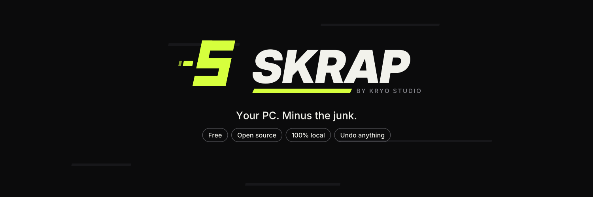

<p align="center">
  
</p>

<p align="center">
  <b>The free, open-source PC cleaner for Windows, made for gamers.</b><br>
  Nothing leaves without you seeing it first, and everything that matters can come back.<br>
  100% local. No account, no ads, no telemetry, no Pro version.
</p>

<p align="center">
  
  
  
</p>

---

> **Skrap is in early development.** There is no download yet.

## Why Skrap

- **You see everything first.** One big *Scan* button, then every item with its size and the reason it can go. Nothing is cleaned until you say so.
- **Everything can come back.** What does not rebuild itself goes to **the Reserve** for 7 days, restorable in one click.
- **Made for gamers.** Shader caches, launcher caches, driver installer leftovers, game logs and dumps: what other cleaners ignore. Skrap never touches a game that is running.
- **Honest.** No "1,254 problems found", no fake health score, no registry cleaner, no RAM booster. It says what it could not clean, and why.
- **Yours.** Everything stays on your PC. The only network call is the update check, and you can turn it off.

Junk is called **la crasse**. Skrap scans, cleans, and leaves your PC **propre**.

## What it will never do

Ads, a mandatory account, telemetry, bundled software in the installer, a paid tier, a scary health score, a registry cleaner, a "RAM booster". It never touches your Documents, Desktop, Pictures, Videos, game saves, cloud folders (OneDrive, Dropbox, Google Drive), the Krak library, or any open file: that list is hard-coded, no rule can get around it.

## Roadmap

See [`docs/ROADMAP.md`](docs/ROADMAP.md) for the phases and what closes each one.

- [x] Skrap identity (direction *Acide*)
- [x] Cleaning engine in Rust: rules, parallel scan, clean, the Reserve, hard-coded protected folders
- [x] 35 rules in English and French: System, Games and launchers, Browsers, Apps
- [x] The app: scan to watch, results with the reason for every item, clean, the Reserve, settings
- [x] Signed in-app updates, offered in the middle of the screen; "What's new" after each update
- [x] CI (format, lints, tests, types, dependency advisories) and the release workflow
- [ ] Phase 0 gate: a tagged build that installs, updates itself and restores everything it kept
- [ ] Phase 1, the core: System, Browsers, Gaming and Apps modules
- [ ] Phase 2, private beta with the Krak community: admin helper, disk analysis (MFT)
- [ ] Phase 3, public launch: code signing, 12 languages, website
- [ ] Phase 4, waves: duplicates, uninstaller, startup apps, privacy settings, scheduled cleaning, community rules

## Building from source

Requirements: Windows 10 or 11, [Node.js](https://nodejs.org) 22+, [Rust](https://rustup.rs) and the Visual Studio C++ build tools ([Tauri prerequisites](https://tauri.app/start/prerequisites/)).

```bash
cd app
npm install
npm run tauri dev     # run the app with hot reload
npm run dev           # or only the interface, in a browser, with demo data
npm run tauri build   # build the installer (needs the update signing key, see docs/RELEASING.md)
```

In the browser preview, `?demo=<screen>` opens a screen directly: `home`, `scanning`, `results`, `cleaning`, `done`, `update`, `whatsnew` (`&still` turns the animations off).

The engine is a Rust workspace at the root of the repository:

```bash
cargo test                                  # the engine
cargo test --workspace                      # the engine and the app
cargo run -p skrap-cli -- scan --lang fr    # what a scan finds on this PC, nothing is deleted
```

How it is put together: [`docs/ARCHITECTURE.md`](docs/ARCHITECTURE.md). How cleaning rules are written: [`docs/RULES.md`](docs/RULES.md). How releases and in-app updates work: [`docs/RELEASING.md`](docs/RELEASING.md).

Built with Rust, [Tauri](https://tauri.app) and [Svelte](https://svelte.dev).

## License

Skrap is free software, released under the [GNU GPL v3.0](LICENSE). You can use it, study it, change it and share it. If you distribute a modified version, it must stay free and open source under the same license, with its source code available.

The **Skrap** and **Kryo Studio** names and logos are not covered by this license. Forks must use their own name and logo: see [TRADEMARKS.md](TRADEMARKS.md) and [NOTICE](NOTICE).

Copyright © 2026 Kryo Studio.
